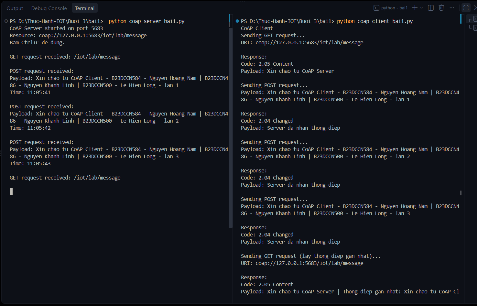
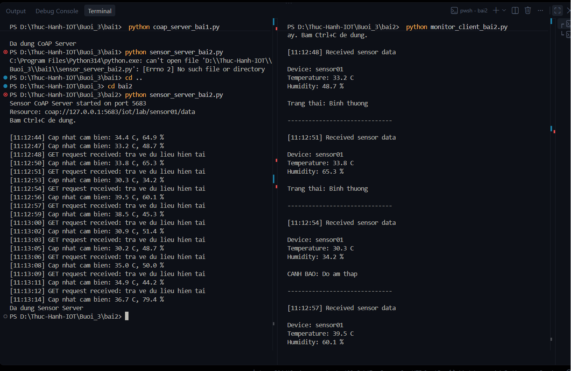
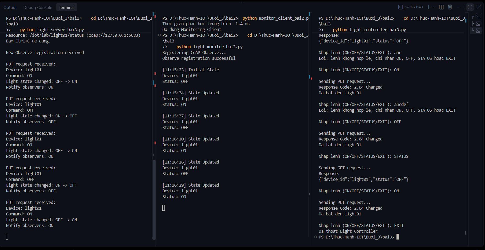

# Thực hành lập trình Python với giao thức CoAP

## 1. Thông tin nhóm thực hiện

| Họ tên | Mã sinh viên | Lớp |
|---|---|---|
| Nguyễn Hoàng Nam | B23DCCN584 | D23CNPM05 |
| Nguyễn Khánh Linh | B23DCCN486 | D23CNPM05 |
| Lê Hiển Long | B23DCCN500 | D23CNPM04 |

## 2. Cấu trúc thư mục

```
Thuc-Hanh-IOT/
└── Buoi_3/
    ├── bai1/
    │   ├── coap_server_bai1.py
    │   └── coap_client_bai1.py
    ├── bai2/
    │   ├── sensor_server_bai2.py
    │   └── monitor_client_bai2.py
    ├── bai3/
    │   ├── light_server_bai3.py
    │   ├── light_controller_bai3.py
    │   └── light_monitor_bai3.py
    └── README.md
```

## 3. Phiên bản Python và thư viện

- Python 3.10 trở lên
- `aiocoap` 0.4.17

CoAP chạy trên UDP (cổng mặc định 5683), **không cần cài MQTT Broker hay RabbitMQ**. Server và Client đều do nhóm tự viết bằng Python.

## 4. Cài đặt môi trường

```
python -m pip install aiocoap
```

Kiểm tra: `python -m pip show aiocoap` (hiện `Name: aiocoap`).

## 5. Địa chỉ IP, cổng và URI các tài nguyên

| Bài | Tài nguyên | URI | Phương thức |
|---|---|---|---|
| 1 | Thông điệp | `coap://127.0.0.1:5683/iot/lab/message` | GET, POST |
| 2 | Cảm biến sensor01 | `coap://127.0.0.1:5683/iot/lab/sensor01/data` | GET |
| 3 | Đèn light01 | `coap://127.0.0.1:5683/iot/lab/light01/status` | GET, PUT, Observe |

- Giao thức: CoAP over UDP, cổng `5683`.
- Địa chỉ mặc định là `127.0.0.1` (máy local), tương đương `localhost`. Nhóm dùng `127.0.0.1` thay cho `localhost` vì trên Windows `localhost` có thể được phân giải thành IPv6 (`::1`) trong khi Server lắng nghe trên IPv4, dẫn đến Client không kết nối được.
- Trên Windows, Server phải bind vào một địa chỉ IP cụ thể (không dùng `0.0.0.0`), nên biến `HOST` ở đầu mỗi file Server được đặt là `127.0.0.1`.

### Chạy Server và Client trên hai máy khác nhau

1. Trong file Server, đổi `HOST` thành địa chỉ IP của máy chạy Server (ví dụ `192.168.1.10`).
2. Trong file Client, đổi `SERVER` thành cùng địa chỉ IP đó.
3. Trên máy chạy Server, mở tường lửa cho **UDP cổng 5683** (Windows Defender Firewall, Inbound Rules, New Rule, Port, UDP, 5683).

## 6. Cách chạy từng chương trình

Mỗi chương trình chạy trong một terminal riêng, đứng trong thư mục tương ứng (bắt đầu từ thư mục `Buoi_3`). **Chạy Server trước, Client sau.** Bấm `Ctrl+C` để dừng.

### Bài 1: Gửi và nhận thông điệp CoAP cơ bản

```
cd bai1
python coap_server_bai1.py        # terminal 1
python coap_client_bai1.py        # terminal 2
```

- Server cung cấp tài nguyên `/iot/lab/message`: GET trả lời chào, POST nhận thông điệp và hiển thị nội dung cùng thời điểm nhận.
- Client gửi GET, sau đó gửi POST 3 lần liên tiếp (mỗi thông điệp chứa họ tên và mã sinh viên của cả 3 thành viên), rồi GET lại để nhận thông điệp POST gần nhất.
- Client còn thử truy cập tài nguyên không tồn tại (nhận mã `4.04 Not Found`) và xử lý lỗi khi Server không hoạt động (timeout hoặc lỗi kết nối).

### Bài 2: Mô phỏng cảm biến nhiệt độ và độ ẩm

```
cd bai2
python sensor_server_bai2.py      # terminal 1
python monitor_client_bai2.py     # terminal 2
```

- Server tự cập nhật dữ liệu cảm biến mỗi 3 giây (nhiệt độ ngẫu nhiên 25 đến 40 °C, độ ẩm 30 đến 80 %). GET trả về JSON với `Content-Format: application/json`:
  ```json
  {"device_id": "sensor01", "temperature": 28.5, "humidity": 65.2, "timestamp": "10:20:03"}
  ```
- Client gửi GET mỗi 3 giây, hiển thị mã thiết bị, nhiệt độ, độ ẩm, thời điểm nhận và cảnh báo:
  - Nhiệt độ > 35 °C: `CANH BAO: Nhiet do cao`
  - Độ ẩm < 40 %: `CANH BAO: Do am thap`
  - Không vi phạm: `Trang thai: Binh thuong`
- Khi bấm Ctrl+C, Client in số lần GET thành công và thời gian phản hồi trung bình. Khi Server không phản hồi, Client báo lỗi và tiếp tục thử lại.

### Bài 3: Giám sát và điều khiển đèn thông minh bằng CoAP Observe

Mở 3 terminal (cùng trong thư mục `bai3`), chạy Server trước, sau đó Monitor, cuối cùng Controller:

```
cd bai3
python light_server_bai3.py       # terminal 1
python light_monitor_bai3.py      # terminal 2
python light_controller_bai3.py   # terminal 3
```

- **Server** (`light_server_bai3.py`): tài nguyên `/iot/lab/light01/status` hỗ trợ GET, PUT và Observe. Trạng thái ban đầu `OFF`. PUT nhận payload:
  ```json
  {"device_id": "light01", "command": "ON"}
  ```
  Khi trạng thái **thực sự thay đổi**, Server cập nhật và thông báo cho tất cả Client đang Observe. Lệnh khác `ON`/`OFF`, payload sai định dạng hoặc sai mã thiết bị bị từ chối bằng mã `4.00 Bad Request`.
- **Controller** (`light_controller_bai3.py`): nhập `ON`, `OFF` (gửi PUT), `STATUS` (gửi GET) hoặc `EXIT`; nhập lệnh khác sẽ báo lỗi.
- **Monitor** (`light_monitor_bai3.py`): đăng ký CoAP Observe (`observe=0`), nhận trạng thái ban đầu và mọi thông báo thay đổi tiếp theo, hiển thị mã thiết bị, trạng thái và thời điểm nhận. Chương trình **không dùng vòng lặp GET** để phát hiện thay đổi. Có thể chạy nhiều Monitor cùng lúc, tất cả đều nhận thông báo.

## 7. Kết quả đạt được

- **Bài 1:** Server chạy và xử lý đúng GET (`2.05 Content`) và POST (`2.04 Changed`), hiển thị nội dung và thời điểm nhận. Client nhận và hiển thị đúng mã phản hồi, payload; xử lý được tài nguyên không tồn tại (`4.04 Not Found`) và lỗi kết nối khi Server không chạy.
- **Bài 2:** Server cập nhật dữ liệu mỗi 3 giây, trả JSON đúng định dạng kèm Content-Format `application/json`. Client truy vấn định kỳ, phân tích JSON, hiển thị đầy đủ thông tin và cảnh báo đúng điều kiện ngưỡng, thống kê số lần GET và thời gian phản hồi trung bình.
- **Bài 3:** Server quản lý tài nguyên đèn, PUT đổi trạng thái đúng lệnh, chỉ thông báo Observe khi trạng thái thay đổi, từ chối lệnh không hợp lệ. Controller điều khiển được đèn bằng ON/OFF/STATUS. Monitor đăng ký Observe thành công và tự động nhận thông báo (không dùng polling); nhiều Monitor nhận thông báo đồng thời.

## 8. Hình ảnh và log minh chứng chương trình hoạt động

Ảnh chụp màn hình các terminal khi chạy (Server và Client cạnh nhau) nằm trong thư mục `images/`. Log bên dưới được copy từ terminal khi nhóm chạy thực tế.

### Bài 1



Log CoAP Server:

```
CoAP Server started on port 5683
Resource: coap://127.0.0.1:5683/iot/lab/message
Bam Ctrl+C de dung.

GET request received: /iot/lab/message

POST request received:
Payload: Xin chao tu CoAP Client - B23DCCN584 - Nguyen Hoang Nam | B23DCCN486 - Nguyen Khanh Linh | B23DCCN500 - Le Hien Long - lan 1
Time: 11:05:41

POST request received:
Payload: Xin chao tu CoAP Client - B23DCCN584 - Nguyen Hoang Nam | B23DCCN486 - Nguyen Khanh Linh | B23DCCN500 - Le Hien Long - lan 2
Time: 11:05:42

POST request received:
Payload: Xin chao tu CoAP Client - B23DCCN584 - Nguyen Hoang Nam | B23DCCN486 - Nguyen Khanh Linh | B23DCCN500 - Le Hien Long - lan 3
Time: 11:05:43

GET request received: /iot/lab/message

Da dung CoAP Server
```

Log CoAP Client:

```
CoAP Client
Sending GET request...
URI: coap://127.0.0.1:5683/iot/lab/message

Response:
Code: 2.05 Content
Payload: Xin chao tu CoAP Server

Sending POST request...
Payload: Xin chao tu CoAP Client - B23DCCN584 - Nguyen Hoang Nam | B23DCCN486 - Nguyen Khanh Linh | B23DCCN500 - Le Hien Long - lan 1

Response:
Code: 2.04 Changed
Payload: Server da nhan thong diep

Sending POST request...
Payload: Xin chao tu CoAP Client - B23DCCN584 - Nguyen Hoang Nam | B23DCCN486 - Nguyen Khanh Linh | B23DCCN500 - Le Hien Long - lan 2

Response:
Code: 2.04 Changed
Payload: Server da nhan thong diep

Sending POST request...
Payload: Xin chao tu CoAP Client - B23DCCN584 - Nguyen Hoang Nam | B23DCCN486 - Nguyen Khanh Linh | B23DCCN500 - Le Hien Long - lan 3

Response:
Code: 2.04 Changed
Payload: Server da nhan thong diep

Sending GET request (lay thong diep gan nhat)...
URI: coap://127.0.0.1:5683/iot/lab/message

Response:
Code: 2.05 Content
Payload: Xin chao tu CoAP Server | Thong diep gan nhat: Xin chao tu CoAP Client - B23DCCN584 - Nguyen Hoang Nam | B23DCCN486 - Nguyen Khanh Linh | B23DCCN500 - Le Hien Long - lan 3

Sending GET request toi tai nguyen khong ton tai...
URI: coap://127.0.0.1:5683/iot/lab/khong_ton_tai

Response:
Code: 4.04 Not Found
Payload: 
```

### Bài 2



Log Sensor Server:

```
Sensor CoAP Server started on port 5683
Resource: coap://127.0.0.1:5683/iot/lab/sensor01/data
Bam Ctrl+C de dung.

[11:12:44] Cap nhat cam bien: 34.4 C, 64.9 %
[11:12:47] Cap nhat cam bien: 33.2 C, 48.7 %
[11:12:48] GET request received: tra ve du lieu hien tai
[11:12:50] Cap nhat cam bien: 33.8 C, 65.3 %
[11:12:51] GET request received: tra ve du lieu hien tai
[11:12:53] Cap nhat cam bien: 30.3 C, 34.2 %
[11:12:54] GET request received: tra ve du lieu hien tai
[11:12:56] Cap nhat cam bien: 39.5 C, 60.1 %
[11:12:57] GET request received: tra ve du lieu hien tai
[11:12:59] Cap nhat cam bien: 38.5 C, 45.3 %
[11:13:00] GET request received: tra ve du lieu hien tai
[11:13:02] Cap nhat cam bien: 30.9 C, 51.4 %
[11:13:03] GET request received: tra ve du lieu hien tai
[11:13:05] Cap nhat cam bien: 30.2 C, 48.7 %
[11:13:06] GET request received: tra ve du lieu hien tai
[11:13:08] Cap nhat cam bien: 35.0 C, 50.0 %
[11:13:09] GET request received: tra ve du lieu hien tai
[11:13:11] Cap nhat cam bien: 34.9 C, 44.2 %
[11:13:12] GET request received: tra ve du lieu hien tai
[11:13:14] Cap nhat cam bien: 36.7 C, 79.4 %
Da dung Sensor Server
```

Log Monitoring Client:

```
Monitoring Client: GET coap://127.0.0.1:5683/iot/lab/sensor01/data moi 3 giay. Bam Ctrl+C de dung.

[11:12:48] Received sensor data

Device: sensor01
Temperature: 33.2 C
Humidity: 48.7 %

Trang thai: Binh thuong

------------------------------

[11:12:51] Received sensor data

Device: sensor01
Temperature: 33.8 C
Humidity: 65.3 %

Trang thai: Binh thuong

------------------------------

[11:12:54] Received sensor data

Device: sensor01
Temperature: 30.3 C
Humidity: 34.2 %

CANH BAO: Do am thap

------------------------------

[11:12:57] Received sensor data

Device: sensor01
Temperature: 39.5 C
Humidity: 60.1 %

CANH BAO: Nhiet do cao

------------------------------

[11:13:00] Received sensor data

Device: sensor01
Temperature: 38.5 C
Humidity: 45.3 %

CANH BAO: Nhiet do cao

------------------------------

[11:13:03] Received sensor data

Device: sensor01
Temperature: 30.9 C
Humidity: 51.4 %

Trang thai: Binh thuong

------------------------------

[11:13:06] Received sensor data

Device: sensor01
Temperature: 30.2 C
Humidity: 48.7 %

Trang thai: Binh thuong

------------------------------

[11:13:09] Received sensor data

Device: sensor01
Temperature: 35.0 C
Humidity: 50.0 %

Trang thai: Binh thuong

------------------------------

[11:13:12] Received sensor data

Device: sensor01
Temperature: 34.9 C
Humidity: 44.2 %

Trang thai: Binh thuong

------------------------------

So lan GET thanh cong: 9
Thoi gian phan hoi trung binh: 1.4 ms
Da dung Monitoring Client
```

### Bài 3



Log Smart Light Server:

```
CoAP Smart Light Server started...
Resource: /iot/lab/light01/status (coap://127.0.0.1:5683)
Bam Ctrl+C de dung.

New Observe registration received

PUT request received:
Device: light01
Command: ON
Light state changed: OFF -> ON
Notify observers: ON

PUT request received:
Device: light01
Command: OFF
Light state changed: ON -> OFF
Notify observers: OFF

PUT request received:
Device: light01
Command: ON
Light state changed: OFF -> ON
Notify observers: ON

PUT request received:
Device: light01
Command: OFF
Light state changed: ON -> OFF
Notify observers: OFF

PUT request received:
Device: light01
Command: ON
Light state changed: OFF -> ON
Notify observers: ON

Mot Client da huy Observe

Da dung Smart Light Server
```

Log Light Controller (có thử nhập lệnh sai `OF`, chương trình báo lỗi và tiếp tục):

```
Nhap lenh (ON/OFF/STATUS/EXIT): ON

Sending PUT request...
Response Code: 2.04 Changed
Da bat den light01

Nhap lenh (ON/OFF/STATUS/EXIT): OFF

Sending PUT request...
Response Code: 2.04 Changed
Da tat den light01

Nhap lenh (ON/OFF/STATUS/EXIT): STATUS

Sending GET request...
Response:
{"device_id":"light01","status":"OFF"} 

Nhap lenh (ON/OFF/STATUS/EXIT): abc
Loi: lenh khong hop le, chi nhan ON, OFF, STATUS hoac EXIT

Nhap lenh (ON/OFF/STATUS/EXIT): ON

Sending PUT request...
Response Code: 2.04 Changed
Da bat den light01

Nhap lenh (ON/OFF/STATUS/EXIT): abcdef
Loi: lenh khong hop le, chi nhan ON, OFF, STATUS hoac EXIT

Nhap lenh (ON/OFF/STATUS/EXIT): OFF

Sending PUT request...
Response Code: 2.04 Changed
Da tat den light01

Nhap lenh (ON/OFF/STATUS/EXIT): STATUS

Sending GET request...
Response:
{"device_id":"light01","status":"OFF"} 

Nhap lenh (ON/OFF/STATUS/EXIT): ON

Sending PUT request...
Response Code: 2.04 Changed
Da bat den light01

Nhap lenh (ON/OFF/STATUS/EXIT): EXIT
Da thoat Light Controller
```

Log Light Monitor (Observe, tự nhận thông báo khi trạng thái thay đổi):

```
Monitoring Client: GET coap://127.0.0.1:5683/iot/lab/sensor01/data moi 3 giay. Bam Ctrl+C de dung.

[11:12:48] Received sensor data

Device: sensor01
Temperature: 33.2 C
Humidity: 48.7 %

Trang thai: Binh thuong

------------------------------

[11:12:51] Received sensor data

Device: sensor01
Temperature: 33.8 C
Humidity: 65.3 %

Trang thai: Binh thuong

------------------------------

[11:12:54] Received sensor data

Device: sensor01
Temperature: 30.3 C
Humidity: 34.2 %

CANH BAO: Do am thap

------------------------------

[11:12:57] Received sensor data

Device: sensor01
Temperature: 39.5 C
Humidity: 60.1 %

CANH BAO: Nhiet do cao

------------------------------

[11:13:00] Received sensor data

Device: sensor01
Temperature: 38.5 C
Humidity: 45.3 %

CANH BAO: Nhiet do cao

------------------------------

[11:13:03] Received sensor data

Device: sensor01
Temperature: 30.9 C
Humidity: 51.4 %

Trang thai: Binh thuong

------------------------------

[11:13:06] Received sensor data

Device: sensor01
Temperature: 30.2 C
Humidity: 48.7 %

Trang thai: Binh thuong

------------------------------

[11:13:09] Received sensor data

Device: sensor01
Temperature: 35.0 C
Humidity: 50.0 %

Trang thai: Binh thuong

------------------------------

[11:13:12] Received sensor data

Device: sensor01
Temperature: 34.9 C
Humidity: 44.2 %

Trang thai: Binh thuong

------------------------------

So lan GET thanh cong: 9
Thoi gian phan hoi trung binh: 1.4 ms
Da dung Monitoring Client
PS D:\Thuc-Hanh-IOT\Buoi_3\bai2>    cd D:\Thuc-Hanh-IOT\Buoi_3\bai3
>>    python light_monitor_bai3.py
Registering CoAP Observe...
Observe registration successful

[11:15:23] Initial State
Device: light01
Status: OFF

[11:15:34] State Updated
Device: light01
Status: ON

[11:15:37] State Updated
Device: light01
Status: OFF

[11:16:10] State Updated
Device: light01
Status: ON

[11:16:16] State Updated
Device: light01
Status: OFF

[11:16:29] State Updated
Device: light01
Status: ON

Da dung Light Monitor
```